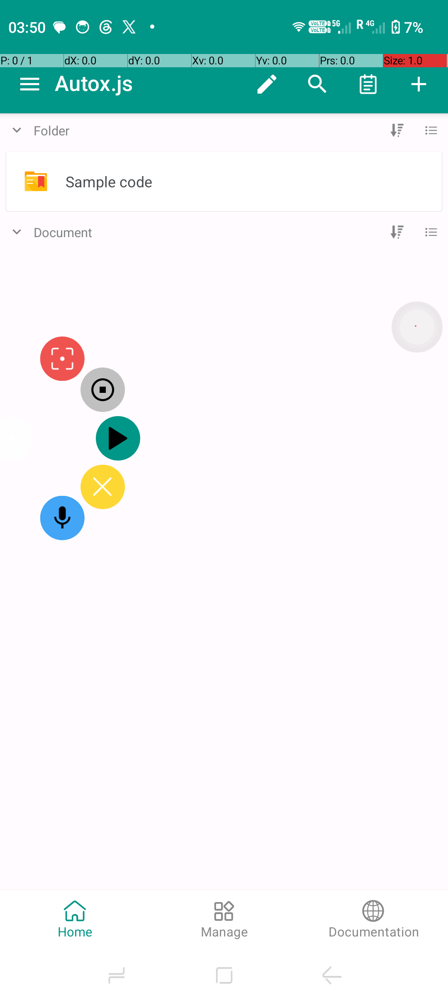
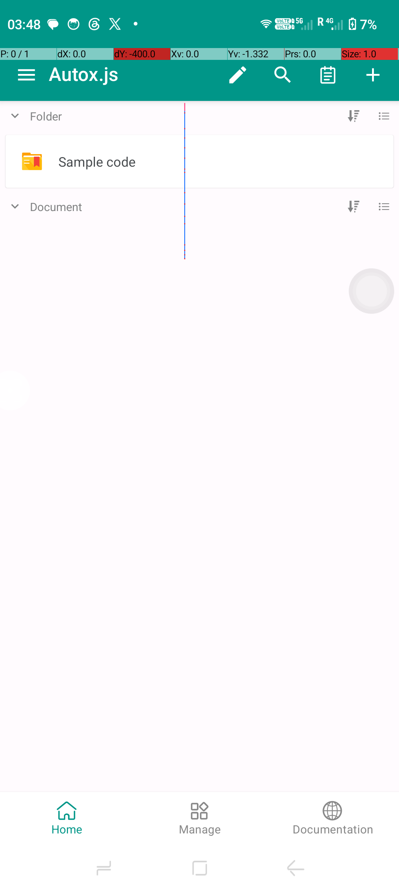
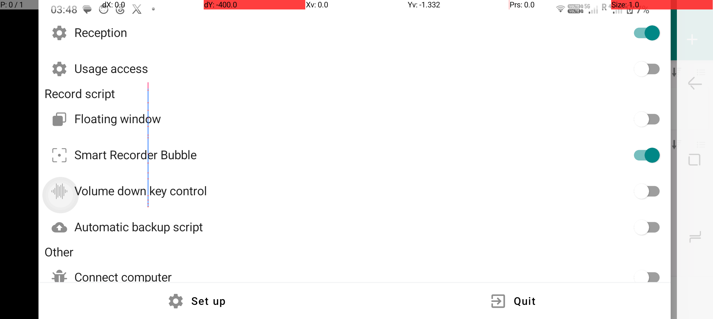
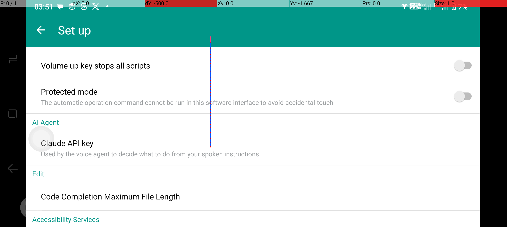
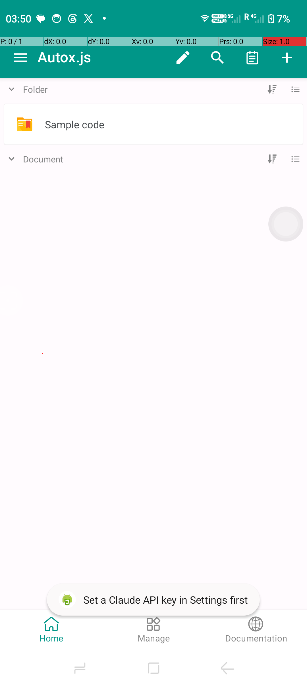

# AutoX.js Voice Agent

A fork of [AutoX.js](https://github.com/kkevsekk1/AutoX) that adds a floating bubble for **recording and replaying automation scripts without writing code**, plus a **push-to-talk AI voice agent** — speak an instruction, and Claude figures out what to tap, type, or wait for on your current screen and does it immediately.



## What's new in this fork

Everything below is additive on top of stock AutoX.js — nothing about the underlying scripting engine, editor, or existing features changed.

### 🔴 Smart Recorder Bubble
A small floating circle sits on your screen. Tap it to reveal five actions:

| Icon | Action |
|---|---|
| 🔴 Record | Start recording your taps, long-presses, text entry, and scrolls |
| ⏹ Stop | Stop recording (or stop an active voice session) and automatically clean up the result |
| ▶ Play | Run the last saved script |
| ✖ Stop all | Kill every currently-running script |
| 🎤 Mic | Start a push-to-talk voice instruction (see below) |

Record a sequence of taps in any app, tap Stop, and the bubble shows you exactly what it captured before asking whether to save it as a script. No gaps, no manual cleanup — a tap sequence with pauses in between is automatically trimmed to just the meaningful steps.

### 🎤 Voice Agent
Tap the mic, speak one instruction ("tap Login", "fill the email field with test@example.com", "scroll down", "wait for the page to load"), and the agent:

1. Reads what's currently on screen (accessibility tree — button labels, field names, visible text)
2. Sends your instruction + that screen description to Claude
3. Gets back exactly one action
4. Performs it immediately
5. Tells you what happened (toast — success or a clear reason it couldn't)

Keep talking to chain instructions one at a time, then tap Stop to save everything you did as a replayable script — through the exact same save flow the recorder uses.

## Screenshots

<table>
<tr>
<td><br/><sub>The bubble floats over any app</sub></td>
<td><br/><sub>Turn it on/off from the drawer</sub></td>
<td><br/><sub>Add your Claude API key once, in Settings</sub></td>
</tr>
</table>

## Getting started

### 1. Build or download the app

```bash
git clone https://github.com/snb9042/autox-voice-agent.git
cd autox-voice-agent
./gradlew :app:assembleCommonDebug
```

The APK lands in `app/build/outputs/apk/common/debug/`. Install the `universal` variant unless you know you want an architecture-specific one.

### 2. Grant the permissions it asks for

The app will prompt for these the first time you need them — just tap through:

- **Accessibility Service** — required for the recorder and the voice agent to see what's on screen and perform taps
- **Display over other apps** — required for the floating bubble
- **Microphone** — required only for the voice agent's mic button, requested the first time you tap it

### 3. Turn on the bubble

Open the app → tap the ☰ menu → scroll to **Record script** → turn on **Smart Recorder Bubble**. The bubble appears and stays visible over every app until you turn it off.

### 4. (Voice agent only) Add your Claude API key

Open the app → ☰ menu → **Set up** → scroll to **AI Agent** → **Claude API key** → paste a key from [console.anthropic.com](https://console.anthropic.com/) → OK.



If you tap the mic before adding a key, you'll get this reminder instead of anything happening — your key is never required just to use the recorder/player.

## How to use it

### Recording a script

1. Tap the bubble → 🔴 Record
2. Go do whatever you want automated — tap buttons, fill in text fields, scroll
3. Tap the bubble → ⏹ Stop
4. Review the step summary, tap **Preview** to see the generated script, then **Save**

The generated script matches by the *text/label* of what you tapped, not fixed coordinates — so it keeps working if the layout shifts slightly. An icon with no readable label falls back to an image match captured at record time.

### Using the voice agent

1. Tap the bubble → 🎤
2. Speak one instruction, e.g. *"tap the Submit button"* or *"type hello@example.com into the email field"*
3. Watch it happen — you'll get a toast telling you what it did (or why it couldn't)
4. Repeat for as many instructions as you like
5. Tap ⏹ **Stop** to end the session — you'll get the same save-as-script prompt as recording

**What it can target:** anything with visible text or an accessible label/content-description — buttons, links, text fields, list items. It cannot currently target an icon-only element whose only readable text comes from OCR (this is a deliberate limitation in this version — see [Known limitations](#known-limitations)).

**Supported instruction types:**
- *Click* / *tap* something by its visible text or label
- *Long-press* something
- *Fill* / *type* text into a field
- *Scroll* up/down/left/right
- *Wait for* something to appear (polls for up to 10 seconds, performs no action itself)

## Known limitations

This is a from-scratch feature built and reviewed carefully, but it's honest about what's still rough:

- **OCR-based screen reading is disabled in this version.** The design originally allowed targeting icon-only labels readable via on-screen text recognition (OCR), but the routing needed to make those targets actually clickable wasn't built yet — rather than ship something that always fails with a timeout, this path is turned off. Voice targeting currently works on accessibility-exposed text/labels only.
- **Tapping Stop while the recognizer is still listening** for your current instruction doesn't interrupt that instruction — it still completes (the action happens on screen) before being discarded from the saved script. A fix is scoped but not yet applied; in practice this only matters if you tap Stop in the ~1-2 second window right after tapping the mic, before you've finished speaking.
- The Claude API key field doesn't mask the key as you type it (cosmetic; your key is still stored locally, never logged or sent anywhere except directly to Anthropic's API over HTTPS).

Full technical detail on both of these — and the reasoning behind every other design decision — lives in [`docs/superpowers/specs/`](docs/superpowers/specs/) and [`docs/superpowers/plans/`](docs/superpowers/plans/).

## How it's built

- **Recorder**: an Android Accessibility Service listens for click/long-click/text-change/scroll events, resolves each one to a stable `(text or description, bounds)` target, and appends a `SemanticAction`. On Stop, an optimizer drops dead time between actions and the result renders to a plain JavaScript file using this project's existing `auto.js` scripting API (`click()`, `setText()`, `swipe()`, etc.) — the output is a normal, readable script, not a black box.
- **Voice agent**: one Claude API call per spoken instruction (tool-use, not free-form code generation) maps your instruction + a text description of the current screen to one of a fixed set of actions, which is rendered through the *same* script generator the recorder uses and executed through the *same* script engine — so every voice-performed action is exactly as inspectable and replayable as a recorded one.

## Credits & license

Built on [AutoX.js](https://github.com/kkevsekk1/AutoX), itself a continuation of [Auto.js](https://github.com/hyb1996/Auto.js) by [hyb1996](https://github.com/hyb1996). See [`docs/UPSTREAM_README_en.md`](docs/UPSTREAM_README_en.md) for the original project's full README and [`docs/UPSTREAM_README_zh.md`](docs/UPSTREAM_README_zh.md) for the Chinese version.

Licensed under [MPL-2.0](https://www.mozilla.org/MPL/2.0/) (non-commercial) + [GPL-2.0](https://opensource.org/licenses/GPL-2.0), consistent with upstream — see the license files in this repository.
